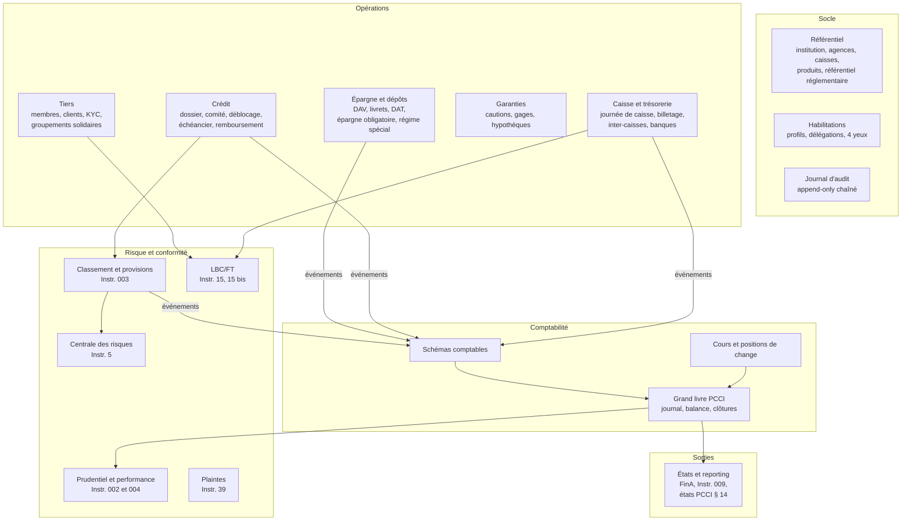

# Likelemba : architecture, version 0.1 (proposition à discuter)

> Nom de travail. *Likelemba*, c'est la tontine en lingala. On le change quand tu veux.

Ce document fixe le socle avant la première ligne de code. Chaque choix renvoie à un texte (PCCI, loi, Instruction BCC) ou à une raison technique écrite. Si un choix n'a ni l'un ni l'autre, il doit sauter.

La matrice détaillée des exigences réglementaires est dans [`../reglementaire/matrice-exigences.md`](../reglementaire/matrice-exigences.md). La direction design est dans [`../design/DESIGN.md`](../design/DESIGN.md).

---

## 1. Ce qu'on construit

Un système de gestion intégré (core banking) pour trois types d'assujettis :

| Profil | Base légale | Ce qui change dans le logiciel |
|---|---|---|
| COOPEC | Loi 002/2002 | On parle de **membres**, de **parts sociales**. Division des risques à 10 % des FPP par membre (Instr. 002, art. 29). Risques totaux plafonnés au double des dépôts (art. 22). États annuels au 6e mois (Instr. 009, art. 1 B). |
| IMF, société de microfinance | Loi 11/020, art. 11 | On parle de **clients**. Division des risques à 5 % des FPP par signature, au-delà accord préalable BCC (Instr. 002, art. 28). États annuels au 4e mois. |
| IMF, entreprise de micro-crédit | Loi 11/020, art. 11 | Pas de collecte d'épargne. Ratio de solvabilité et de liquidité non applicables (Instr. 002, art. 12 et 16). Instructions 53 et 54 en plus. |
| Faîtière | Instr. 0011 | Consolidation réseau (Instr. 002, art. 2 al. 2), comptes de liaison, refinancement des affiliées. |

Un seul produit. Le **profil réglementaire** de l'institution active ou désactive des règles. Il ne crée pas de branche de code.

### Et Microfina++ ?

Manuel lu en entier (MEDIASOFT, v0.1, 2022, 306 pages), croisé avec les deux notes d'une mission d'octobre 2026 dans une COOPEC utilisatrice. L'analyse complète est dans [`../analyse/microfina-ecarts.md`](../analyse/microfina-ecarts.md). Trois choses à retenir :

1. **Le périmètre fonctionnel est bon.** On reprend l'essentiel : guichet à onglets, circuit de visa à trois niveaux sur le crédit, DAT avec reconduction, plan d'épargne, liste rouge, budget, immobilisations.
2. **Il est conçu pour l'UEMOA, pas pour la RDC.** Il suit le référentiel des SFD, pas le PCCI. Il n'a pas FinA. Il parle de BIC au lieu de la centrale des risques de la BCC, et son découpage administratif est ouest-africain.
3. **Ses contrôles sont optionnels.** Billetage à cocher, séparation des tâches laissée aux droits, suppression et annulation possibles, provisions lancées par bouton. Sur 26 constats d'usage dans cette COOPEC, 20 portent sur des fonctions qui existent mais qu'on peut contourner. D'où le principe P8.

---

## 2. Les sept règles qui dictent tout le reste

Ces règles ne se négocient pas. Elles viennent des textes. Le reste de l'architecture en découle.

1. **Partie double, en français, en monnaie nationale** (PCCI § 3.2). Toute écriture est équilibrée. Le CDF est la monnaie de tenue. Les devises sont converties au cours du jour (PCCI § 7.1).
2. **Irréversibilité** (PCCI § 3.4). Aucune suppression, aucune modification d'une écriture validée. Une erreur se corrige par contre-passation, puis par l'écriture juste (PCCI § 3.3).
3. **Clôture informatique mensuelle** (PCCI § 3.4). Une opération datée dans une période close est passée au premier jour de la période ouverte. Sa date de valeur reste visible dans le libellé.
4. **Piste d'audit dans les deux sens** (Instr. 008, art. 11). De la pièce au bilan, du bilan à la pièce, sans rupture.
5. **Attributs d'identification sur chaque opération** (PCCI § 10) : résidence, agent économique, appartenance au réseau, statut de la créance, durée initiale, durée résiduelle, garantie, monnaie.
6. **Pas d'opération de change** (PCCI § 7.1, dernier alinéa). Un compte en USD se mouvemente en USD. Le logiciel interdit la conversion pour le compte d'un membre.
7. **Conservation dix ans** (PCCI § 3.5). Livres, pièces, états numérotés et datés.

---

## 3. Principes d'architecture

### P1. Un seul grand livre. Les soldes des membres en sont une vue.

Le problème classique de ce type de logiciel : la balance des comptes de membres ne colle pas avec le 330 du grand livre. On passe des jours à chercher l'écart. Microfina++ a même un écran pour ça, « Contrôle des comptes », qui affiche l'écart entre gestion et comptabilité (manuel, p. 163). Dans la COOPEC auditée, les encours par produit ne concordent pas avec la comptabilité (constat C3).

Ici, il n'y a pas deux livres. Chaque ligne d'écriture porte :
- un **compte général** PCCI (ex. `3300 Épargnes`) ;
- en option, une **référence de contrat** (le compte d'épargne n° 0412-000318-USD, le prêt n° P-2026-00871).

Le solde d'un compte de membre, c'est la somme des lignes qui portent sa référence. La balance auxiliaire et la balance générale sont deux regroupements des mêmes lignes. Elles ne peuvent pas diverger. C'est une propriété du modèle, pas un contrôle qu'on lance le soir.

### P2. Le métier ne passe jamais d'écriture à la main

Le module épargne ne connaît pas le PCCI. Il émet un **événement métier** : `RetraitEspeces{compte, montant, devise, caisse}`. Un **schéma comptable** traduit l'événement en lignes : débit 330x, crédit 570x.

Les schémas sont des **données**, pas du code :
- un schéma par couple (type d'événement, produit) ;
- versionnés, avec date d'effet ;
- modifiables par le comptable habilité, avec validation à quatre yeux ;
- une modification ne réécrit jamais le passé.

Avantage direct : une COOPEC qui détaille ses comptes divisionnaires (PCCI § 9 l'autorise) le fait dans les schémas, sans développeur.

### P3. Trois dates sur chaque opération

| Date | Ce que c'est | Qui la fixe |
|---|---|---|
| Horodatage | L'instant réel de saisie | Le serveur, jamais l'utilisateur |
| Date de valeur | Date économique (intérêts, retards) | La règle produit, ou un utilisateur habilité |
| Date comptable | La journée comptable ouverte de l'agence | Le cycle de journée (§ 6) |

Le cas PCCI § 3.4 (valeur dans une période close) devient mécanique : date comptable = premier jour ouvert, date de valeur conservée, libellé enrichi automatiquement.

### P4. L'argent est un type, pas un nombre

- Montant = entier en unités mineures + code devise. Jamais de flottant.
- Chaque ligne porte le montant en devise **et** sa contre-valeur CDF, avec la référence du cours utilisé.
- Les règles d'arrondi sont écrites, testées, et une seule fonction les applique.
- Une écriture est équilibrée **par devise**. Seules les écritures de réévaluation (positions de change, comptes 472, 473, 474) s'équilibrent en CDF seul.

### P5. Le réglementaire est un référentiel versionné, avec ses sources

Taux de provision, tranches de retard, normes des ratios, seuils LBC : tout vit dans un **référentiel réglementaire**. Chaque valeur porte :
- sa source (`Instr. 003, art. 12`) ;
- sa date d'effet ;
- la version de l'instruction (ex. `Instr. 41 mod. 1 du 04/07/2023`).

Quand la BCC modifie une instruction, on ajoute une version. On ne touche pas au code. Et l'interface affiche la source à côté de la règle appliquée (voir DESIGN.md).

### P6. Monolithe modulaire. Pas de microservices.

Un dépôt touche l'épargne, la caisse et la comptabilité. Il doit réussir ou échouer en bloc. Dans un monolithe avec une base PostgreSQL, c'est une transaction. En microservices, c'est une saga, des compensations et des incohérences temporaires sur de l'argent. Pour une équipe réduite, c'est un mauvais pari.

Les frontières entre modules sont réelles : un module n'accède pas aux tables d'un autre. Elles sont vérifiées par des tests d'architecture à chaque build. Si un jour un module doit sortir (reporting, mobile money), la frontière existe déjà.

### P7. Quatre yeux, paramétrables

Toute opération sensible passe par un circuit **saisie / validation** (maker-checker) : seuils par profil et par type d'opération, extourne, modification d'un schéma comptable, déblocage de crédit au-delà de la délégation, déblocage d'une épargne bloquée. Le valideur ne peut jamais être le saisisseur. La règle est dans le moteur, pas dans l'écran.

### P8. Ce que la BCC exige n'est pas une option

C'est la leçon de Microfina++ sur le terrain. On peut régler un seuil. On ne peut jamais désactiver le contrôle lui-même. Concrètement, aucun paramètre, aucun profil, pas même l'administrateur, ne permet de :
- comptabiliser une journée avec une caisse non arrêtée ou un billetage non validé ;
- saisir et valider la même opération ;
- modifier ou supprimer une écriture validée ;
- débiter un compte d'épargne au-delà de son disponible ;
- utiliser en caisse un compte qui n'a pas reçu son visa ;
- débloquer un crédit qui dépasse le plafond par membre ou par client, ou le plafond des apparentés, sans l'autorisation prévue par le texte ;
- modifier un crédit approuvé sans nouvelle approbation ;
- sauter le classement et le provisionnement mensuels ;
- couper le journal d'audit.

Chacun de ces blocages a un test automatisé qui doit échouer si quelqu'un le contourne.

---

## 4. Découpage en modules



| Module | Possède | Ne fait jamais |
|---|---|---|
| Référentiel | Institution, profil réglementaire, agences, guichets, caisses, produits versionnés, référentiel réglementaire | Calculer quoi que ce soit |
| Habilitations | Utilisateurs, profils, délégations par montant, circuits de validation | Décider à la place d'un module métier |
| Tiers | Personnes physiques, morales, groupements solidaires (cf. PCCI 1031), pièces d'identité, photo, specimen de signature, mandataires, apparentés (Instr. 002, art. 27), attributs PCCI § 10.1 et 10.2 | Tenir un solde |
| Épargne | Contrats de dépôt, conditions, intérêts créditeurs, blocages (saisie-arrêt, compte 361), épargne obligatoire liée à un prêt | Écrire en comptabilité |
| Crédit | Dossiers, analyse, comité, déblocage, échéanciers, remboursements, pénalités, prorogation unique (Instr. 003, art. 5), TEG (Instr. 38) | Classer ou provisionner (c'est Classement) |
| Garanties | Garanties par type PCCI § 10.8, valorisation, hors bilan | |
| Caisse | Journée de caisse, fonds de caisse, billetage par coupure et devise, transferts inter-caisses (579, 590), écarts | Ouvrir une journée comptable (c'est le GL) |
| Schémas comptables | Traduction événement vers écriture | Être contourné |
| Grand livre | Écritures, journaux, balance, journées et périodes, clôtures, contre-passations | Accepter une écriture déséquilibrée ou modifiée |
| Cours et change | Cours du jour, réévaluations, comptes 472 à 474 | Proposer une opération de change à un membre |
| Classement et provisions | Retards quotidiens, passage en 39xx par tranche, provisions 38xx, intérêts des litigieux en hors bilan (Instr. 003, art. 11), passage en perte au 31/12 (art. 10) | |
| Prudentiel | FPP, solvabilité, liquidité, division des risques, positions de change, immobilisations, ratios Instr. 004 | Lire autre chose que le GL et le référentiel |
| LBC/FT | Profil de risque client, seuils espèces, alertes, déclarations | |
| Centrale des risques | Déclarations à la CR (Instr. 5), modifications, radiations | |
| Plaintes | Registre, référence unique, délai de 45 jours (Instr. 39, art. 5) | |
| Reporting | États mensuels et annuels (Instr. 009), FinA, tableau des flux de trésorerie, états PCCI, rapport d'activités, calendrier des transmissions avec accusés | Recalculer à côté du GL |
| Immobilisations | Biens, familles et comptes, acquisition, amortissement, réévaluation, inventaire, sortie | Laisser l'acquisition se comptabiliser à la main |
| Budget | Centres de coût, plans, lignes, bailleurs, réalisé contre prévu, subventions par convention | |
| Registres de contrôle | Incidents et fraudes, recommandations CAC, BCC et conseil de surveillance, autorisations d'activités connexes, imprimés de valeur | Se substituer aux organes |

**Hors périmètre** : GRH, stocks, calcul de la paie. Les avances et retenues sur salaire entrent dans le noyau (créances sur le personnel, prélèvements sur comptes domiciliés). Le journal de paie s'importe.

---

## 5. Noyau de données

Le noyau, c'est le grand livre. Le reste peut évoluer. Lui, non.

```sql
-- Journée comptable : une par agence et par date
create table journee_comptable (
  id            bigint generated always as identity primary key,
  agence_id     bigint not null references agence,
  date_comptable date  not null,
  statut        text   not null check (statut in ('ouverte','en_cloture','fermee')),
  unique (agence_id, date_comptable)
);

-- Période mensuelle : la clôture informatique du PCCI § 3.4
create table periode (
  institution_id bigint not null,
  annee  int not null,
  mois   int not null check (mois between 1 and 12),
  statut text not null check (statut in ('ouverte','cloturee')),
  cloturee_le timestamptz,
  cloturee_par bigint,
  primary key (institution_id, annee, mois)
);

create table ecriture (
  id              bigint generated always as identity primary key,
  numero          text not null unique,        -- séquence sans trou par journal et période
  journal         text not null,               -- caisse, opérations diverses, provisions...
  journee_id      bigint not null references journee_comptable,
  date_valeur     date not null,
  horodatage      timestamptz not null default now(),
  libelle         text not null,
  piece_id        bigint not null references piece,   -- PCCI § 3.2 : pas d'écriture sans pièce
  evenement_id    uuid   not null,                    -- l'événement métier d'origine
  schema_version  bigint not null,                    -- quel schéma comptable a produit l'écriture
  contre_passe_id bigint references ecriture,         -- si c'est une extourne
  saisi_par       bigint not null,
  valide_par      bigint                               -- 4 yeux, différent de saisi_par
);

create table ligne_ecriture (
  ecriture_id     bigint not null references ecriture,
  rang            smallint not null,
  compte_general  text   not null references compte_pcci,
  contrat_ref     text,                 -- compte d'épargne, prêt... : la vue auxiliaire
  sens            char(1) not null check (sens in ('D','C')),
  devise          char(3) not null,
  montant_devise  bigint  not null check (montant_devise > 0),  -- unités mineures
  montant_cdf     bigint  not null check (montant_cdf > 0),
  cours_id        bigint references cours_change,
  -- attributs PCCI § 10, copiés au moment de l'écriture pour figer l'historique
  residence       text, agent_economique text, reseau text,
  duree_initiale  text, duree_residuelle text, type_garantie text,
  primary key (ecriture_id, rang)
);
```

Ce que la base garantit elle-même, sans faire confiance au code applicatif :
- **Équilibre** : trigger différé en fin de transaction, débit = crédit par devise et en CDF.
- **Irréversibilité** : le rôle applicatif n'a pas `UPDATE` ni `DELETE` sur `ecriture` et `ligne_ecriture`. Un trigger refuse toute insertion dans une période clôturée.
- **Numérotation sans trou** : séquence par journal et période, attribuée dans la transaction.
- **Quatre yeux** : contrainte `valide_par <> saisi_par`.

Le reste du modèle (tiers, contrats, échéanciers, garanties, produits) est décrit module par module dans `docs/architecture/modules/` au fil des itérations.

---

## 6. Cycle de vie : la journée, le mois, l'exercice

```
JOURNÉE (par agence)
  ouverture journée comptable ── chef d'agence
    └─ ouverture des caisses : fonds de caisse, billetage d'ouverture par devise
         └─ opérations au guichet et en back-office
    └─ arrêté de chaque caisse : billetage de clôture, écart constaté et justifié
  traitements de fin de journée (automatiques, rejouables, idempotents)
    · intérêts courus (épargne, DAT, crédit)
    · calcul des retards, contagion aux autres crédits du membre (Instr. 003, art. 6 al. 2)
    · reclassement par tranche 3900 à 3904
    · pénalités
  contrôles bloquants avant fermeture
    · toutes les caisses arrêtées, billetages validés
    · comptes 579, 59 et de liaison soldés, sinon justification nominative
    · équilibre par journal et par devise
  fermeture journée

MOIS
  dotations et reprises de provisions 3800 à 3804 (Instr. 003, art. 12 : chaque mois)
  réévaluation des positions de change (PCCI § 7.1)
  calcul des ratios prudentiels et de performance
  production des états du 15 (Instr. 009, art. 1 A)
  clôture informatique : la période passe à « clôturée », plus rien n'y entre

EXERCICE
  passage en perte des irrécupérables au 31/12, suivi en hors bilan (Instr. 003, art. 10)
  détermination du résultat, affectation (réserve générale ≥ 15 %, Instr. 002, art. 19)
  à-nouveaux
```

Un traitement de fin de journée qui plante ne laisse rien à moitié. Chaque étape est une transaction, marquée comme faite, rejouable sans doublon.

---

## 7. Réseau, agences, connectivité

C'est la décision qui pèse le plus. Trois options.

| Option | Principe | Pour | Contre |
|---|---|---|---|
| **A. Centralisé en ligne** | Une base au siège, les agences en navigateur | Un seul grand livre, soldes toujours justes, maintenance simple | Le guichet s'arrête si le lien tombe |
| B. Base par agence, synchronisation | Chaque agence a sa base, remontée au siège | Le guichet tourne sans réseau | Deux retraits sur le même compte dans deux agences, conflits, consolidation lourde |
| C. Hybride | A par défaut, nœud local pour les agences isolées, consolidé par comptes de liaison 450 et 451 | Couvre le terrain réel | Deux modes à maintenir |

**Ma recommandation : A, avec liaison de secours (4G en plus de la fibre ou du VSAT), et C seulement pour une agence qui le justifie.** Dans ce cas, l'agence isolée est traitée comme une entité comptable à part, reliée par les comptes de liaison prévus au PCCI. Ses membres ne peuvent pas opérer ailleurs tant qu'elle n'est pas consolidée.

Je refuse le mode « hors ligne puis on synchronise » au guichet pour l'épargne. Un retrait hors ligne, c'est un solde qu'on ne connaît pas. Sur de l'argent, ce n'est pas un détail.

---

## 8. Pile technique

| Couche | Choix proposé | Pourquoi |
|---|---|---|
| Base | PostgreSQL 16 | Transactions sérieuses, contraintes, triggers différés, sécurité par ligne si plusieurs institutions, partitionnement par exercice pour les dix ans de conservation |
| Serveur | Kotlin sur la JVM, Spring Boot avec Spring Modulith | `BigDecimal` natif, typage fort, frontières de modules vérifiées, écosystème bancaire mature |
| Accès données | jOOQ (SQL explicite) | Sur un grand livre, je veux lire le SQL, pas deviner ce qu'un ORM génère |
| Interface | React et TypeScript, composants maison sur primitives accessibles (Radix) | Le design system est à nous (voir DESIGN.md), pas celui d'un kit |
| Impressions | Gabarits PDF générés côté serveur, reçus thermiques 80 mm | Le papier fait partie du produit |
| Authentification | Comptes locaux, TOTP pour les profils sensibles, session liée au poste | Instr. 008, art. 16 : accès et authentification maîtrisés |
| Déploiement | Conteneurs, sur site ou en hébergement, sauvegardes chiffrées hors site | Instr. 36 : continuité d'activité |

Alternatives sérieuses : .NET (même solidité) ou TypeScript côté serveur (une seule langue, mais l'arithmétique décimale demande une discipline constante). **Le bon choix dépend de qui va coder.** Dis-moi qui compose l'équipe et je fige.

---

## 9. Sécurité et contrôle interne

- **Séparation des fonctions** : l'administrateur système n'a aucun droit métier. Le responsable sécurité informatique est un rôle distinct de l'exploitation (Instr. 008, art. 16).
- **Habilitations** par agence, par caisse, par produit, par montant.
- **Journal d'audit** en ajout seul, chaque entrée chaînée par empreinte à la précédente. Toute consultation de données sensibles y figure, pas seulement les modifications.
- **Détection** : alertes sur opérations hors horaires, extournes en série, opérations sur comptes du personnel et des apparentés.
- **Auditeur et inspecteur BCC** : profil en lecture seule, accès à la piste d'audit complète et à la documentation (PCCI § 3.4, dernier tiret sur le chemin de révision).

---

## 10. Ce qui reste ouvert

Je bloque sur ces points. Il me faut ta réponse avant de figer.

1. **Paie.** Je propose de garder les avances et retenues dans le noyau et d'importer le journal de paie. Ou tu veux un module paie complet comme dans Microfina++ ?
2. **Pour qui d'abord ?** Une COOPEC isolée, un réseau avec faîtière, ou des IMF ? Ça change l'ordre des modules.
3. **Connectivité réelle des agences visées.** Fibre, 4G, VSAT, rien ?
4. **Équipe.** Qui code, avec quelles langues ? Ça tranche la pile (§ 8).
5. **Format FinA.** Il faut la spécification exacte (gabarits, codes de postes) auprès de la DSIF de la BCC. Sans elle, le module reporting reste un squelette.
6. **Mono ou multi-institution ?** Un éditeur qui héberge plusieurs COOPEC, ou une installation par institution ?
7. **Mobile money et agents** (Instr. 24 et 29). Phase 1 ou plus tard ?

---

## 11. Ordre de construction proposé

| Étape | Contenu | Critère de sortie |
|---|---|---|
| 0. Socle | Référentiel, habilitations, audit, grand livre, journées et périodes, schémas comptables | Une écriture saisie, validée à quatre yeux, visible au journal et en balance, impossible à modifier |
| 1. Guichet | Tiers et KYC de base, épargne, caisse et billetage | Une journée complète d'agence : ouverture, dépôts, retraits, arrêté de caisse, fermeture, balance juste |
| 2. Crédit | Dossier, comité, déblocage, échéancier, remboursements, classement et provisions | Un portefeuille vieilli sur 200 jours simulés, provisions conformes à l'Instr. 003 |
| 3. Pilotage | Prudentiel, Instr. 004, états mensuels et FinA, flux de trésorerie, centrale des risques, immobilisations, budget | Les états du 15 sortis sans retouche manuelle |
| 4. Conformité | LBC/FT complet, plaintes, registres de contrôle, TEG et publication des conditions | |
| 5. Extensions | Faîtière et consolidation, mobile money, agents | |
